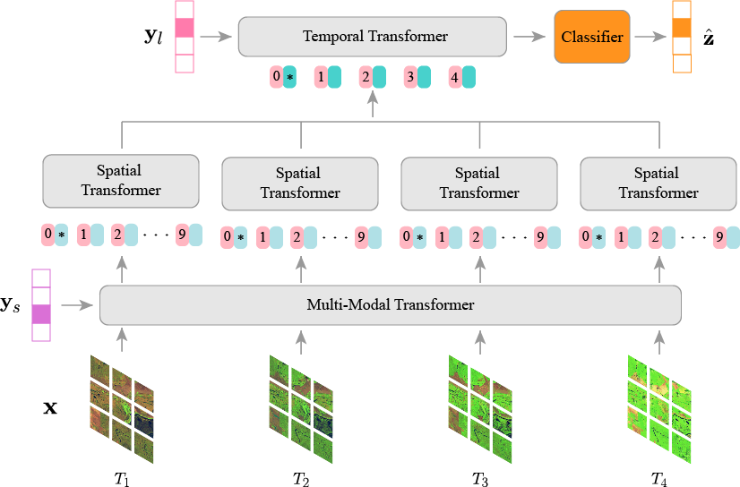

# MMST-ViT: Multi-Modal Spatio-Temporal Vision Transformer for Crop Yield Forecasting

A deep learning framework for agricultural yield prediction using multi-modal data including satellite imagery, weather data, and historical crop statistics.

## Overview

This project implements the MMST-ViT (Multi-Modal Spatio-Temporal Vision Transformer) architecture for crop yield forecasting. The model combines:

- **Satellite Imagery**: Sentinel-2 satellite images capturing crop growth patterns
- **Short-term Weather Data**: HRRR (High-Resolution Rapid Refresh) daily meteorological variables
- **Long-term Climate Data**: Historical monthly weather patterns
- **Crop Statistics**: USDA crop production and yield data

## Architecture



The model consists of three main components:

1. **PVT-SimCLR Backbone**: A Pyramid Vision Transformer pre-trained with contrastive learning (SimCLR) for extracting visual features from satellite imagery
2. **Spatial Transformer**: Aggregates features across spatial grids within a county
3. **Temporal Transformer**: Models temporal dependencies across the growing season

## Project Structure

```
yield-forecasting-transformer/
├── main_pretrain_mmst_vit.py   # Pre-training script (SimCLR contrastive learning)
├── main_finetune_mmst_vit.py   # Fine-tuning script (yield prediction)
│
├── models_mmst_vit.py          # MMST-ViT model architecture
├── models_pvt_simclr.py        # PVT backbone with SimCLR projection head
├── models_pvt.py               # Pyramid Vision Transformer implementation
├── attention.py                # Attention modules (spatial, temporal, multi-modal)
│
├── dataset/                    # Data loading modules
│   ├── sentinel_loader.py      # Sentinel-2 satellite imagery loader
│   ├── hrrr_loader.py          # HRRR weather data loader
│   ├── usda_loader.py          # USDA crop statistics loader
│   └── data_wrapper.py         # Data augmentation wrapper
│
├── loss/                       # Loss functions
│   └── contrastive_loss.py     # NT-Xent contrastive loss for SimCLR
│
├── util/                       # Utility functions
│   ├── misc.py                 # Distributed training, logging, checkpointing
│   ├── metrics.py              # Evaluation metrics (RMSE, R², PCC)
│   └── lr_sched.py             # Learning rate schedulers
│
├── config/                     # Configuration builders
│   └── build_config_soybean.py # Builds the data index files
│
├── data/                       # Dataset index files
│   ├── soybean_train.json      # Training data index
│   └── soybean_val.json        # Validation data index
│
├── input/                      # County lists used to build the index
│   └── county_info_{2021,2022}.csv
│
├── tests/                      # pytest suite (synthetic data, CPU)
├── docs/                       # Figures from the paper
└── papers/                     # Reference paper (ICCV 2023)
```

## Installation

Use a plain virtual environment so every package comes from pip:

```bash
python -m venv venv
source venv/bin/activate      # Windows: .\venv\Scripts\activate
pip install -r requirements.txt
pip install pytest && pytest   # tests run on synthetic data, no download needed
```

> **Conda users:** don't install into a conda base environment. pip's `torch` bundles its own
> OpenMP runtime and conda's `numpy` loads another, which aborts with
> `OMP: Error #15: Initializing libomp.dylib, but found libomp.dylib already initialized`.
> Create the venv from any Python 3.10+ (including conda's) and install with pip as above.

## Usage

### 1. Pre-training (SimCLR)

Pre-train the PVT backbone with contrastive learning:

```bash
python main_pretrain_mmst_vit.py \
    --root_dir /path/to/cropnet/data \
    --data_file ./data/soybean_train.json \
    --batch_size 32 \
    --epochs 200 \
    --output_dir ./output_dir/pvt_simclr
```

### 2. Fine-tuning (Yield Prediction)

Fine-tune the full MMST-ViT model for yield prediction:

```bash
python main_finetune_mmst_vit.py \
    --root_dir /path/to/cropnet/data \
    --data_file_train ./data/soybean_train.json \
    --data_file_val ./data/soybean_val.json \
    --pvt_simclr ./output_dir/pvt_simclr/checkpoint-199.pth \
    --batch_size 64 \
    --epochs 200 \
    --output_dir ./output_dir/mmst_vit
```

Fine-tuning back-propagates through the backbone for every tile of a county (up to 6 × 31 = 186
tiles in the default index). On machines with ≤16 GB of memory add `--grad_checkpointing`: gradients
are identical, peak memory is bounded by one `--batch_size` chunk of tiles (measured 5.8 → 2.2 GB for
72 tiles), at the cost of one extra backbone forward per step.

### 3. Evaluation

```bash
python main_finetune_mmst_vit.py \
    --eval \
    --resume ./output_dir/mmst_vit/checkpoint-best.pth \
    --root_dir /path/to/cropnet/data \
    --data_file_val ./data/soybean_val.json
```

## Testing

```bash
pip install pytest
pytest
```

The suite (`tests/`, ~40 s on CPU) builds a tiny synthetic dataset with the real file layout and checks:

- model forward passes and output shapes
- the loaders (1st-of-month imagery, weather tensors, USDA targets) and that the index never
  uses the prediction year as climate history
- an end-to-end run: pre-training → fine-tuning with the pre-trained backbone → `--eval`,
  including the saved metrics and predictions

GitHub Actions runs it on every push and pull request.

## Data

The repo only holds index files; the data comes from
[Tiny CropNet](https://huggingface.co/datasets/fudong03/Tiny-CropNet) (~358 GB in full).
`download_data.py` fetches just the files the index references into `./data/TinyCropNet`:

```bash
python download_data.py                                  # USDA + HRRR weather (~1.9 GB)
python download_data.py --modalities sentinel            # Sentinel-2 imagery, indexed counties only (~1 GB)
```

Each Sentinel-2 file covers a whole state for a quarter (~4 GB). The script reads them remotely with
HTTP range requests and keeps only the indexed counties and the 1st-of-month images the loader uses;
`--full_sentinel` downloads the complete files (~59 GB for the default index) instead.
Pass `--root_dir ./data/TinyCropNet` to the training scripts.

## Data Index

`data/soybean_train.json` (2021) and `data/soybean_val.json` (2022) list, for each county, the files the
loaders read. Long-term climate input is the monthly HRRR data from the **three years before** the
prediction year, as in the paper (e.g. 2018–2020 for 2021). Rebuild them with:

```bash
python -m config.build_config_soybean                      # default 10 counties, 3 years
python -m config.build_config_soybean --fips 17091 19117 --long_term_years 3
```

## Data Format

### Sentinel-2 Imagery
- Format: HDF5, one file per state and quarter: `<FIPS>/<YYYY-MM-DD>/data` holds a county's
  `(G, 384, 384, 3)` uint8 tiles (G = number of 9×9 km grid cells), taken on the 1st and 15th of each month
- Loader output: `(T, G, H, W, C)` with the 1st-of-month images for April–September (T = 6)

### HRRR Weather Data
- Format: CSV files with daily/monthly meteorological variables
- Variables: Temperature, Precipitation, Humidity, Wind, Radiation, VPD

### USDA Data
- Format: CSV files with annual crop statistics
- Variables: Production (bushels), Yield (bushels/acre)

## Model Parameters

| Parameter | Default | Description |
|-----------|---------|-------------|
| `--batch_size` | 64 | Batch size per GPU |
| `--embed_dim` | 512 | Embedding dimension |
| `--epochs` | 200 | Number of training epochs |
| `--lr` | 1e-3 | Learning rate |
| `--warmup_epochs` | 40 | Warmup epochs for LR scheduler |
| `--weight_decay` | 0.05 | Weight decay |

## Metrics

- **RMSE**: Root Mean Square Error
- **R²**: Coefficient of determination
- **PCC**: Pearson Correlation Coefficient

## Citation

If you use this code, please cite:

```bibtex
@inproceedings{lin2023mmst,
  title={MMST-ViT: Climate Change-aware Crop Yield Prediction via Multi-Modal Spatial-Temporal Vision Transformer},
  author={Lin, Fudong and Crawford, Summer and Guillot, Kaleb and Zhang, Yihe and Chen, Yan and Yuan, Xu and others},
  booktitle={Proceedings of the IEEE/CVF International Conference on Computer Vision (ICCV)},
  year={2023}
}
```

## License

See [LICENSE](LICENSE) for details.
