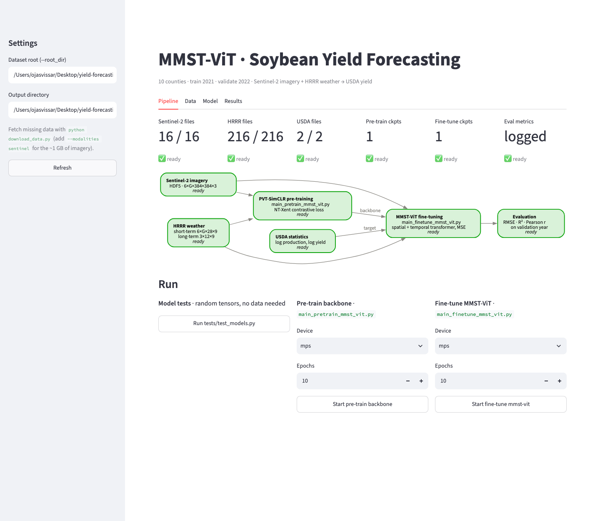
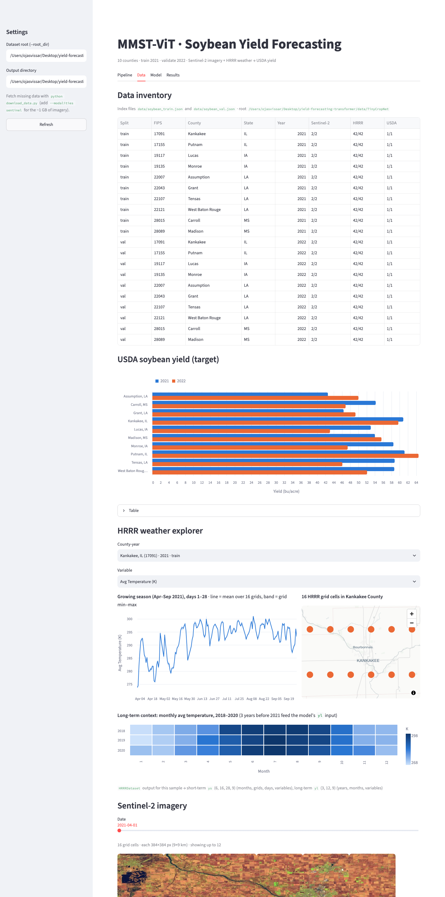
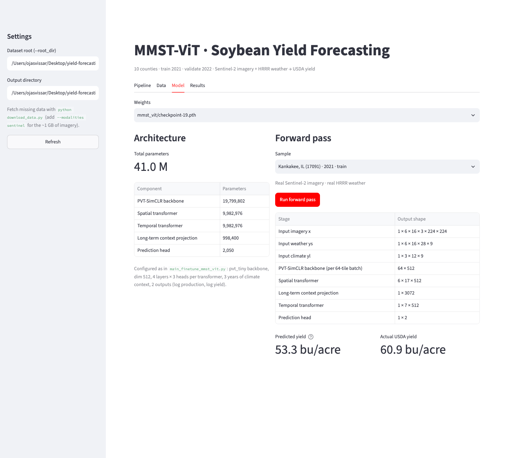
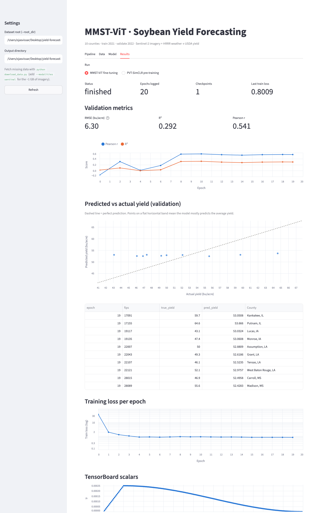

# MMST-ViT: Multi-Modal Spatio-Temporal Vision Transformer for Crop Yield Forecasting

County-level soybean yield prediction from Sentinel-2 satellite imagery, HRRR weather and USDA crop
statistics, implementing [MMST-ViT (Lin et al., ICCV 2023)](papers/).

The model combines:

- **Satellite imagery**: Sentinel-2 tiles of each 9×9 km grid cell in a county, monthly through the growing season
- **Short-term weather**: daily HRRR variables (temperature, precipitation, humidity, wind, radiation, VPD) for April–September
- **Long-term climate**: monthly HRRR variables for the three years before the prediction year
- **Target**: USDA production and yield (bu/acre)

## Dashboard

```bash
streamlit run app.py
```

| Pipeline | Data |
|---|---|
|  |  |
| **Model** | **Results** |
|  |  |

- **Pipeline**: status of each stage (data → pre-training → fine-tuning → evaluation), plus buttons to
  run the model tests and to launch training
- **Data**: what is downloaded, USDA target yields, a weather explorer with a map of the county's grid
  cells, and the Sentinel-2 tiles
- **Model**: parameter counts and a forward pass on a real county that traces tensor shapes stage by stage
- **Results**: training loss, validation RMSE / R² / r, predicted vs. actual yield per county

## Architecture


1. **Multi-Modal Transformer** (PVT-Tiny backbone + cross-attention): each satellite tile attends to its
   grid cell's daily weather, giving one vector per tile. Pre-trained with multi-modal SimCLR
   (`main_pretrain_mmst_vit.py`).
2. **Spatial Transformer**: attends across a county's grid cells, giving one vector per month.
3. **Temporal Transformer**: attends across the months, with the long-term climate added as a bias to
   the attention scores, giving one vector per county-year.
4. **Linear head**: predicts log production and log yield.

## Quick start

```bash
# 1. environment
python -m venv venv
source venv/bin/activate      # Windows: .\venv\Scripts\activate
pip install -r requirements.txt

# 2. data for the 10 indexed counties (~2.7 GB)
python download_data.py --modalities usda hrrr sentinel

# 3. pre-train the backbone, then fine-tune and evaluate
python main_pretrain_mmst_vit.py --root_dir ./data/TinyCropNet --epochs 20 --warmup_epochs 2
python main_finetune_mmst_vit.py --root_dir ./data/TinyCropNet --epochs 20 --warmup_epochs 2 \
    --pvt_simclr ./output_dir/pvt_simclr/checkpoint-19.pth --grad_checkpointing --batch_size 16 --lr 2.5e-4

# 4. inspect everything
streamlit run app.py
```

> **Conda users:** don't install into a conda base environment. pip's `torch` bundles its own
> OpenMP runtime and conda's `numpy` loads another, which aborts with
> `OMP: Error #15: Initializing libomp.dylib, but found libomp.dylib already initialized`.
> Create the venv from any Python 3.10+ (including conda's) and install with pip as above.

## Data

The repo only holds index files; the data comes from
[Tiny CropNet](https://huggingface.co/datasets/fudong03/Tiny-CropNet) (~358 GB in full).
`download_data.py` fetches just the files the index references into `./data/TinyCropNet`:

```bash
python download_data.py                                  # USDA + HRRR weather (~1.9 GB)
python download_data.py --modalities sentinel            # Sentinel-2 imagery, indexed counties only (~0.8 GB)
```

Each Sentinel-2 file covers a whole state for a quarter (~4 GB). The script reads them remotely with
HTTP range requests and keeps only the indexed counties and the 1st-of-month images the loader uses;
`--full_sentinel` downloads the complete files (~59 GB for the default index) instead.

### Data index

`data/soybean_train.json` (2021) and `data/soybean_val.json` (2022) list, for each county, the files the
loaders read. Long-term climate input is the monthly HRRR data from the **three years before** the
prediction year, as in the paper (e.g. 2018–2020 for 2021). Rebuild them with:

```bash
python -m config.build_config_soybean                      # default 10 counties, 3 years
python -m config.build_config_soybean --fips 17091 19117 --long_term_years 3
```

### Data format

| Source | File | Loader output |
|---|---|---|
| Sentinel-2 | HDF5 per state and quarter; `<FIPS>/<YYYY-MM-DD>/data` holds a county's `(G, 384, 384, 3)` uint8 tiles, taken on the 1st and 15th of each month | `(6, G, 384, 384, 3)`: 1st-of-month images, April–September |
| HRRR | CSV per state and month, daily and monthly rows per grid cell, 9 variables | short-term `(6, G, 28, 9)`, long-term `(3, 12, 9)` |
| USDA | CSV per crop and year | `log([production, yield])` |

G is the number of 9×9 km grid cells in the county (2–31 in the default index).

## Training

Both scripts pick the device automatically (CUDA → Apple MPS → CPU); override with `--device`.

| Flag | Pre-training | Fine-tuning | Notes |
|---|---|---|---|
| `--epochs` | 200 | 200 | |
| `--warmup_epochs` | 20 | 40 | linear warm-up, then cosine decay |
| `--blr` | 1e-3 | 1e-3 | base LR; actual `lr = blr × batch_size / 256` unless `--lr` is given |
| `--batch_size` | 32 | 64 | pre-training: tiles per SimCLR batch; fine-tuning: tiles per backbone chunk (one county per step) |
| `--weight_decay` | 0.05 | 0.05 | AdamW |
| `--save_freq` | 5 | 2 | fine-tuning also evaluates on the validation year at each save |
| `--grad_checkpointing` | – | off | recompute backbone activations in backward; same gradients, memory bounded by one chunk |

Fine-tuning back-propagates through the backbone for every tile of a county (up to 6 × 31 = 186 tiles
in the default index). With `--grad_checkpointing` peak memory depends on the chunk size
(`--batch_size`) instead of the county size. Measured for one 186-tile step on an M-series Mac (MPS):

| `--batch_size` (tiles per chunk) | peak memory | time per step |
|---|---|---|
| 64 | 13 GB (swapping on 16 GB) | 39 s |
| 16 | 4.5 GB | 3 s |

Each fine-tuning step is one county regardless of `--batch_size`, so when lowering it pass `--lr`
explicitly (the default `lr = blr × batch_size / 256` would shrink with it).

Outputs go to `./output_dir/{pvt_simclr,mmst_vit}`: `checkpoint-<epoch>.pth`, `log.txt` (train loss per
epoch), TensorBoard events and, for fine-tuning, `metrics.txt` (validation metrics per evaluation) and
`predictions.csv` (per-county predicted vs. actual yield).

Evaluate a checkpoint on the validation year:

```bash
python main_finetune_mmst_vit.py --eval --root_dir ./data/TinyCropNet \
    --resume ./output_dir/mmst_vit/checkpoint-19.pth
```

## Metrics

Computed on yield (bu/acre) after undoing the log transform:

- **RMSE**: root mean squared error
- **R²**: squared Pearson correlation, as reported in the paper (0.918² = 0.843 for soybean)
- **r**: Pearson correlation coefficient

## Results

A demo run on the default index (10 counties; train on 2021, validate on 2022) on an Apple M-series
laptop (MPS), with the Quick start commands:

- **Pre-training**: 20 epochs, 40 min; contrastive loss 3.82 → 2.81
- **Fine-tuning**: 20 epochs, 13 min (`--grad_checkpointing --batch_size 16 --lr 2.5e-4 --num_workers 0`)

Validation (2022 soybean yield, 10 counties):

| Predictor | RMSE (bu/acre) ↓ | Pearson r ↑ |
|---|---|---|
| MMST-ViT, epoch 19 | **6.30** | **0.54** |
| 2021 average yield for every county | 7.16 | – |
| Each county's 2021 yield | 7.47 | 0.40 |
| *Paper (200+ counties, 2021)* | *3.9* | *0.918* |

The model beats both naive baselines but stays far from the paper: its predictions span only
52.4–53.7 bu/acre, so with 10 training samples it has learned the average yield plus a weak ranking
of counties (see the Results screenshot above). Reproducing the paper needs the full county set:
add counties with `python -m config.build_config_soybean --fips ...` and download them with
`download_data.py`.

## Testing

```bash
pip install pytest
pytest
```

The suite (`tests/`, ~1 min on CPU) builds a tiny synthetic dataset with the real file layout and checks:

- model forward passes and output shapes, and that gradient checkpointing leaves gradients unchanged
- the loaders (1st-of-month imagery, weather tensors, USDA targets) and that the index never
  uses the prediction year as climate history
- an end-to-end run: pre-training → fine-tuning with the pre-trained backbone → `--eval`,
  including the saved metrics and predictions
- the dashboard renders with no data and with a finished run

GitHub Actions runs it on every push and pull request.

## Project structure

```
yield-forecasting-transformer/
├── app.py                      # Streamlit dashboard
├── download_data.py            # Fetches the dataset subset the index uses
├── main_pretrain_mmst_vit.py   # Pre-training (multi-modal SimCLR)
├── main_finetune_mmst_vit.py   # Fine-tuning and evaluation (yield prediction)
│
├── models_mmst_vit.py          # MMST-ViT
├── models_pvt_simclr.py        # PVT backbone + multi-modal attention head
├── models_pvt.py               # Pyramid Vision Transformer
├── attention.py                # Multi-modal, spatial and temporal attention
│
├── dataset/                    # Sentinel-2, HRRR and USDA loaders, augmentations
├── loss/                       # NT-Xent contrastive loss
├── util/                       # Training utilities, LR schedule, metrics
├── config/                     # Builds the data index files
├── data/                       # Index files (soybean_train.json, soybean_val.json)
├── input/                      # County lists used to build the index
├── tests/                      # pytest suite (synthetic data, CPU)
├── ss/                         # Dashboard screenshots
├── docs/                       # Figures from the paper
└── papers/                     # Reference paper (ICCV 2023)
```

## Citation

```bibtex
@inproceedings{lin2023mmst,
  title={MMST-ViT: Climate Change-aware Crop Yield Prediction via Multi-Modal Spatial-Temporal Vision Transformer},
  author={Lin, Fudong and Crawford, Summer and Guillot, Kaleb and Zhang, Yihe and Chen, Yan and Yuan, Xu and others},
  booktitle={Proceedings of the IEEE/CVF International Conference on Computer Vision (ICCV)},
  year={2023}
}
```

## License

See [LICENSE](LICENSE) for details.
